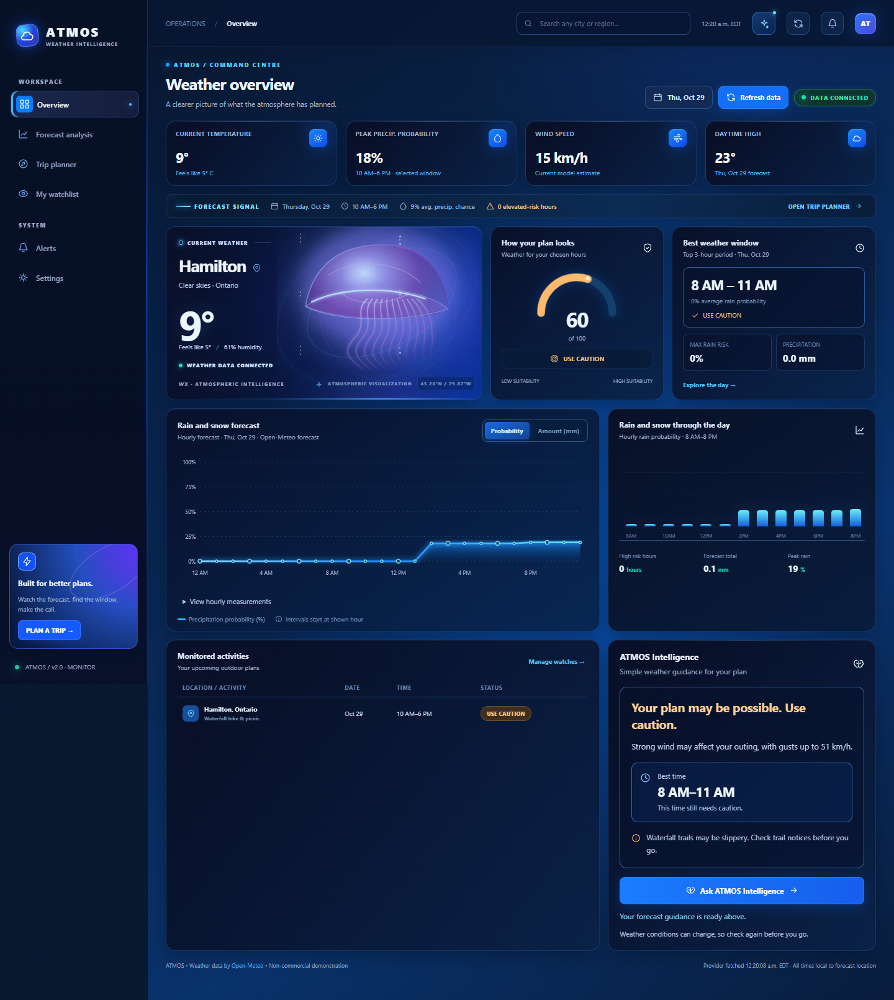

# ATMOS — Your Weather & Outdoor Planning Dashboard

Plan an outing with a clearer view of the weather. ATMOS brings live forecasts, hourly rain and snow charts, saved plans, and simple weather guidance into a dark navy and electric-blue dashboard.

**[Open ATMOS](https://weather-day-planner.vercel.app)** · [Public source repository](https://github.com/Ameer-sys/weather-day-planner) · [Latest release checks](RELEASE.md)



[Mobile view](assets/mobile-live.png) · [Verification](VERIFICATION.md) · [Deployment guide](DEPLOYMENT.md)

## Run locally

Requires **Node.js 22 or later**. There are no runtime dependencies to install.

```sh
git clone https://github.com/Ameer-sys/weather-day-planner.git
cd weather-day-planner
npm run dev
```

Open **http://localhost:3000**. Internet access is needed for live weather. To explore an explicitly labelled sample, open `http://localhost:3000/?demo=1`. Demo weather is fictional and never used as a silent fallback.

## What you can do

- Search for a city and view current conditions and up to 16 days of forecasts.
- Compare hourly precipitation probability and amounts, with a keyboard-accessible chart and data table.
- Choose a date, activity and time range, then compare three-hour outing windows.
- Read ATMOS Intelligence as a recommendation, reason, best time and practical precautions.
- Save up to 30 plans in your browser. While the tab is open, ATMOS checks saved locations and records meaningful forecast changes.
- Switch Celsius/Fahrenheit, control weather animations, and respect your device's reduced-motion setting.

The starting plan is a Hamilton, Ontario waterfall hike and picnic on **October 29, 2026, 10 AM–6 PM**. It is editable. When a chosen date is outside the available forecast, ATMOS keeps that date and explains that weather is unavailable.

## Guidance without extra setup

ATMOS Intelligence works without an OpenAI account or key. Its forecast-based assessment remains available when optional extra explanations cannot be fetched. Missing or outdated weather pauses recommendations rather than treating unknown values as clear weather.

For developers who want optional local OpenAI explanations, see [DEPLOYMENT.md](DEPLOYMENT.md). Secrets stay on the server. **Paid AI is disabled on public Vercel deployments** until authentication and durable spending controls exist.

## Development checks

```sh
npm run check
npm test
npm run build
```

The build copies only six approved browser assets to `dist/`. API code stays server-side. GitHub Actions runs these same checks on pushes and pull requests.

`npm run test:browser` additionally uses an existing Playwright installation and Microsoft Edge. It verifies real Hamilton API calls, then isolated failure/race fixtures and responsive screens. Set `PLAYWRIGHT_MODULES` to the absolute path of an existing `node_modules` directory when needed. Local screenshots and evidence are written to ignored `artifacts/`.

Set `ATMOS_TEST_URL=https://weather-day-planner.vercel.app` to run those browser checks against the deployed app. Test-only responses and saved plans remain isolated to the test browser.

`npm run test:layout` uses the same Playwright setup to check all six pages at 1440, 1920, 2560, 3440, 768 and 390 CSS pixels. It checks viewport coverage, overflow, desktop padding, chart proportions and containment, plus ultrawide error-state layout. Screenshots are saved in `artifacts/layout/` for visual review.

## Project structure

| Path | Purpose |
| --- | --- |
| `index.html`, `styles.css` | Page shell, visual design and responsive layouts |
| `app.js` | Dashboard pages, controls and watchlists |
| `weather.js` | Forecast normalization, timezone handling and assessment rules |
| `guidance.js` | Short, understandable guidance from the assessment |
| `server.mjs`, `backend.mjs` | Local HTTP entry point and shared API handler |
| `api/` | Vercel serverless entry points |
| `scripts/` | Public build and browser verification |
| `test/` | Offline unit and API regression tests |
| `assets/` | Screenshots, original design reference and icon |
| `.github/workflows/checks.yml` | GitHub continuous integration |

## Hosting

**GitHub is the source-control platform. Vercel hosts the live application.** Both use the name `weather-day-planner`. A free Vercel domain is used initially. `weatherdayplanner.com` is a preferred future domain; no purchase is automatic.

GitHub Pages serves static files only and cannot run this project's Node API routes. A static demo could be adapted for Pages, but the full live app needs a backend-capable host. **GitHub Pages is not configured.** See the [deployment guide](DEPLOYMENT.md) for Vercel details and verification.

## Weather and planning limits

Forecasts are estimates and can change. Plan scores help compare options; they do not guarantee a safe outing. Check official weather warnings, trail closures and local conditions before leaving.

Hourly precipitation includes rain, showers and snow water equivalent. ATMOS labels the start of each hour and converts UTC timestamps using the location's timezone, including daylight-saving changes. Probability and amount are different measures. The animated artwork is decorative, not radar.

Saved plans and alert history belong to this browser. Closed-tab alerts, email delivery, accounts and official weather-warning feeds are not implemented.

Weather and location search are powered by [Open-Meteo](https://open-meteo.com/). Review its [usage terms](https://open-meteo.com/en/terms), particularly before commercial use.
